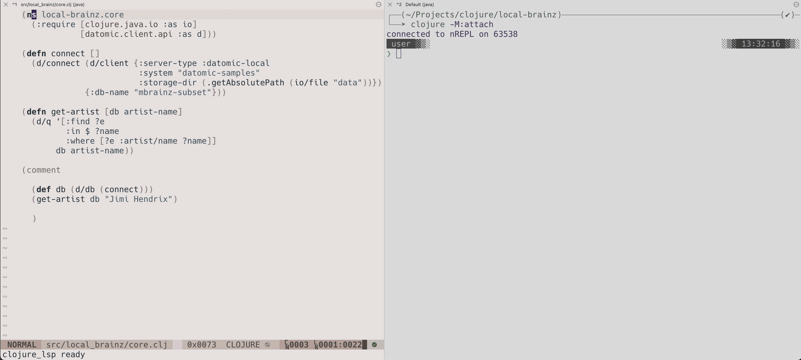

# Editors

When an editor connects to the REPL server with nREPL, the terminal REPL shows
each evaluation that the editor sends, with the prompt, the namespace that the
code ran in, the code, and the output.



Connecting this way brings any existing editor workflow closer to the REPL and
lets you use the [inspector](inspector.md) in the terminal to open results
of editor evaluations. [Hooks](hooks.md) and [middleware](middleware.md) from your configuration apply
to editor evaluations, and with [`:follow-editor-ns`](#namespace) the terminal enters
the namespace of each editor evaluation and requires your [`:auto-require`](configuration.md#auto-require) libspecs into it.

## Connecting

Start the REPL with `clojure -M:repl`. Editors connect through the `.nrepl-port`
file that it writes.

* Conjure: connects when you open a Clojure file. If the REPL is not running,
  it can be started automatically with `vim.g["conjure#client#clojure#nrepl#connection#auto_repl#cmd"] = "clojure -M:serve"`.
* Calva: run "Calva: Connect to a Running REPL Server in your Project". For Jack-in
  to start the server, add a custom connect sequence with
  `"customJackInCommandLine": "clojure -M:serve"` and `"nReplPortFile": [".nrepl-port"]`.
* CIDER: run `cider-connect`. For `cider-jack-in` to start the server, set
  `cider-jack-in-cmd` to `"clojure -M:serve"`.

When an editor starts the server, run `clojure -M:attach` to launch the terminal
REPL, by hand or scripted from your editor.

## Code echo

Set `:echo-editor-code` to `false` to show only the output of each editor evaluation.

```clojure
;; .cljconf/org.clojure/clojure-cli.repl.edn
{:echo-editor-code false}
```

## Namespace

Each editor evaluation runs in the namespace of the file that the code comes
from. By default, the terminal namespace does not change. Set
`:follow-editor-ns` to `true` to make the terminal enter the namespace of each editor evaluation.

```clojure
;; .cljconf/org.clojure/clojure-cli.repl.edn
{:follow-editor-ns true}
```

## cider-nrepl

Calva and CIDER use cider-nrepl for some features, such as the debugger and the
test runner. To use them, add cider-nrepl to the server. See [third-party middleware](middleware.md).
